

<picture><source media="(max-width: 600px)" srcset="assets/hero-mobile.svg" /></picture>

  <a href="https://web2.qatar.cmu.edu/~mshikfa/"><b>Portfolio ↗</b></a> &nbsp; / &nbsp;
  <a href="mailto:mshikfa@andrew.cmu.edu"><b>Say hello ↗</b></a>

I'm **Mohamed**, a **Computer Science senior at Carnegie Mellon University in Qatar, Class of 2027**. I write software, build robots, teach CS, and make games. I’m happiest somewhere between a clean abstraction and a prototype on the bench.

**Currently exploring:** modular flight · magnetic mechanisms · active perception.

<a href="#research">Research</a> &nbsp; · &nbsp; <a href="#graphics">Graphics</a> &nbsp; · &nbsp; <a href="#coursework">Coursework</a> &nbsp; · &nbsp; <a href="#notes">Notes</a> &nbsp; · &nbsp; <a href="#community">Community</a>

### 01 / Research & simulations

My research focuses on modular drones, magnetic mechanisms, and camera positioning for robots.

<a href="https://github.com/Mohamed-Waiel-Shikfa/Modular_Multi_UAV_Systems"><picture><source media="(max-width: 600px)" srcset="assets/project-uav-mobile.svg" /></picture></a>

<a href="https://github.com/Mohamed-Waiel-Shikfa/Active_Vertical_Perception_System_UGV"><picture><source media="(max-width: 600px)" srcset="assets/project-ugv-mobile.svg" /></picture></a>

<a href="https://github.com/Mohamed-Waiel-Shikfa/magsim"><picture><source media="(max-width: 600px)" srcset="assets/project-magsim-mobile.svg" /></picture></a>

<a href="https://github.com/Mohamed-Waiel-Shikfa/epm-review"><picture><source media="(max-width: 600px)" srcset="assets/project-review-mobile.svg" /></picture></a>

### 02 / Graphics & learning tools

I contribute to CMU Graphics and work on tools and hardware for running student games.

<a href="https://github.com/cmu-cs-academy/desktop-cmu-graphics/pulls?q=is%3Apr+author%3AMohamed-Waiel-Shikfa"><picture><source media="(max-width: 600px)" srcset="assets/project-graphics-mobile.svg" /></picture></a>
<a href="https://github.com/Mohamed-Waiel-Shikfa/arcade-box-15112"><picture><source media="(max-width: 600px)" srcset="assets/project-arcade-mobile.svg" /></picture></a>

<a href="https://github.com/Mohamed-Waiel-Shikfa/r36s_handheld_console"><picture><source media="(max-width: 600px)" srcset="assets/project-r36s-mobile.svg" /></picture></a>
<a href="https://github.com/Mohamed-Waiel-Shikfa/Edge-project"><picture><source media="(max-width: 600px)" srcset="assets/project-logic-mobile.svg" /></picture></a>

My merged CMU Graphics contributions include a [sound-engine rewrite](https://github.com/cmu-cs-academy/desktop-cmu-graphics/pull/74), a [window-resizing fix](https://github.com/cmu-cs-academy/desktop-cmu-graphics/pull/64), and [test maintenance](https://github.com/cmu-cs-academy/desktop-cmu-graphics/pull/100). I also contributed to the **CMU-Q arcade machines** and helped maintain them.

### 03 / Coursework & experiments

A few projects from my courses and experiments outside class.

<a href="https://github.com/Mohamed-Waiel-Shikfa/Dim3"><picture><source media="(max-width: 600px)" srcset="assets/project-dim3-mobile.svg" /></picture></a>
<a href="https://github.com/Mohamed-Waiel-Shikfa/Term-project"><picture><source media="(max-width: 600px)" srcset="assets/project-salem-mobile.svg" /></picture></a>

<a href="https://github.com/CMU-17313Q/opencode-f26-commitment_issues"><picture><source media="(max-width: 600px)" srcset="assets/project-opencode-mobile.svg" /></picture></a>
<a href="https://review.opendev.org/c/openstack/openstacksdk/+/922610"><picture><source media="(max-width: 600px)" srcset="assets/project-ironic-mobile.svg" /></picture></a>

Also: [Cofactor Expansion](https://github.com/Mohamed-Waiel-Shikfa/Cofactor-Expansion-Research), an experiment in determinant recursion and algorithmic cost.

### 04 / Notes & shared notebooks

Some course notes I've made or contributed to that saved me in more than a few battles with exams.

<a href="https://github.com/Mohamed-Waiel-Shikfa/Integration_And_Approximation_notes"><picture><source media="(max-width: 600px)" srcset="assets/note-calculus-mobile.svg" /></picture></a>
<a href="https://github.com/Mohamed-Waiel-Shikfa/ML_in_a_Nutshell_notes"><picture><source media="(max-width: 600px)" srcset="assets/note-ml-mobile.svg" /></picture></a>
<a href="https://github.com/Mohamed-Waiel-Shikfa/Networking_and_the_Internet_notes"><picture><source media="(max-width: 600px)" srcset="assets/note-networking-mobile.svg" /></picture></a>

<a href="https://github.com/Mohamed-Waiel-Shikfa/15316-Notes"><picture><source media="(max-width: 600px)" srcset="assets/note-security-mobile.svg" /></picture></a>
<a href="https://github.com/Mohamed-Waiel-Shikfa/collective_intelligence_notes"><picture><source media="(max-width: 600px)" srcset="assets/note-collective-mobile.svg" /></picture></a>
<a href="https://github.com/Mohamed-Waiel-Shikfa/matrices-notes"><picture><source media="(max-width: 600px)" srcset="assets/note-matrices-mobile.svg" /></picture></a>

### 05 / Community & upstream

| Community | What I do |
| :--- | :--- |
| [Open CMUQ](https://github.com/open-cmuq) | President, supporting student projects including [CountsFor](https://github.com/open-cmuq/CountsFor) and [YallaEvents](https://github.com/open-cmuq/YallaEvents). |
| [Functional Programming](https://web2.qatar.cmu.edu/cs/15150/) | Lead course assistant; I also teach across programming, data structures, logic, and theory. |
| [OpenStack / Ironic](https://review.opendev.org/c/openstack/openstacksdk/+/922610) | Summer of Code course and internship experience contributing to real-world infrastructure. |
| [Game Development Club](https://github.com/GDC-CMU) | Executive team member and contributor to [Farm Patch](https://github.com/GDC-CMU/PassTheGame). |

<b>Milestones</b> · <a href="https://www.qatar.cmu.edu/news/cmu-q-names-class-of-2027-qatar-campus-scholars/">Andrew Carnegie Society &amp; Qatar Campus Scholar</a> · <a href="https://www.qatar.cmu.edu/news/cmu-qatar-meeting-of-the-minds-2026-undergraduate-research-symposium/">1st place, Meeting of the Minds 2026 (Early Research)</a> · 2nd place, Qatar Collegiate Programming Contest 2024

**Software:** Python · C · C++ · Rust · Standard ML · TypeScript · JavaScript · Bash · LaTeX · Linux · Git · Docker · x86-64. 

**Robotics & hardware:** ROS 2 · Gazebo · PyBullet · MuJoCo · Arduino · Raspberry Pi · KiCad · SPICE · custom electronics · simulation · control · prototyping. 

**Creative work:** Blender · Pygame · games · animation · photography.

### 06 / Repository constellation

<a href="https://github.com/Mohamed-Waiel-Shikfa?tab=repositories"><picture><source media="(max-width: 600px)" srcset="assets/activity-mobile.svg" /></picture></a>

---

**Have a robot, open-source tool, or game idea in mind?** [Let’s make something.](mailto:mshikfa@andrew.cmu.edu)

<picture><source media="(max-width: 600px)" srcset="assets/footer-mobile.svg" /></picture>
